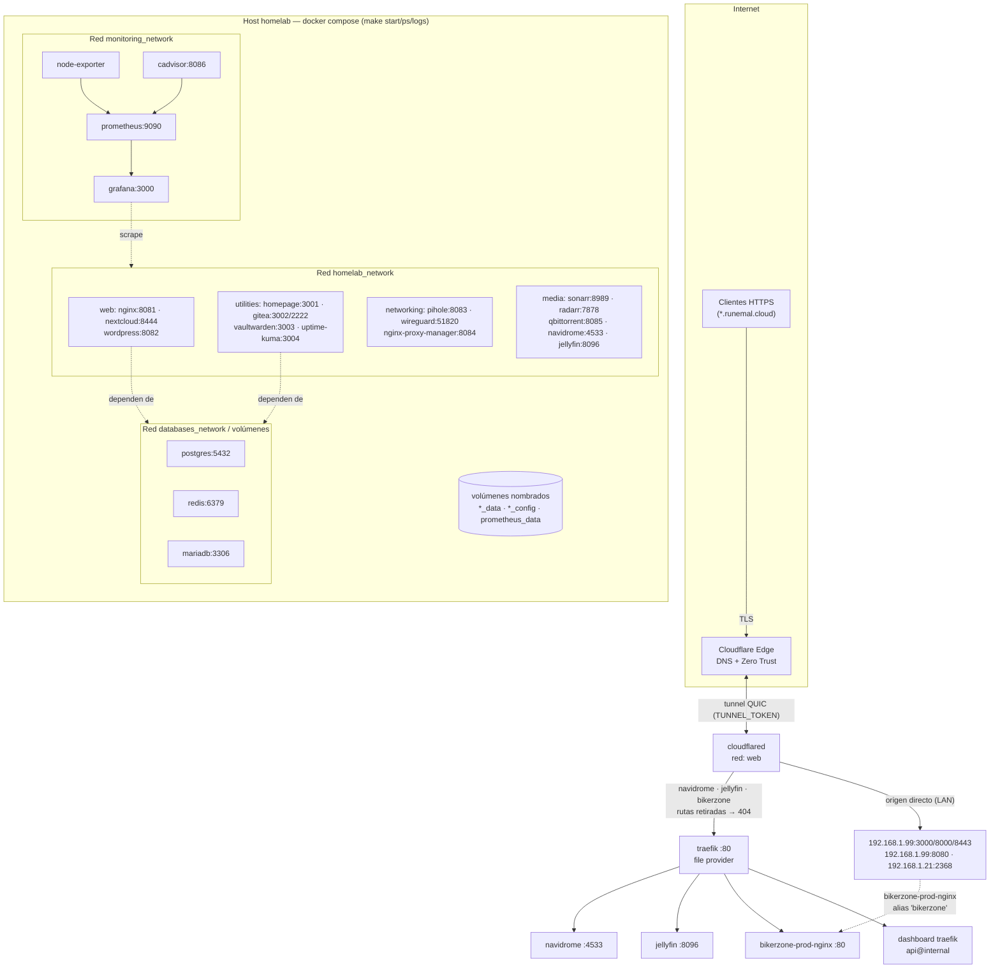
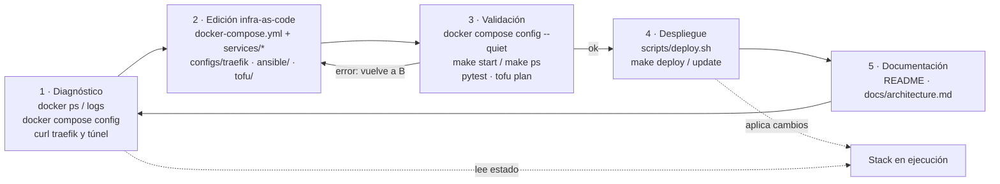

# Arquitectura del homelab

Mapa de servicios actuales y del flujo de trabajo con `opencode`.
Fuente de verdad: `docker-compose.yml`, `services/*/docker-compose*.yml`,
`configs/traefik/` y los stacks de `ansible/` + `tofu/`.

## Servicios y publicación

### Redes

| Red | Uso |
|---|---|
| `homelab_network` | backbone: casi todos los servicios |
| `web_network` | `traefik`, `cloudflared` y los backends publicados |
| `monitoring_network` | prometheus, grafana, node-exporter, cadvisor |
| `databases_network` / `networking_network` | aislamiento de DBs y de pihole/wireguard/NPM |

### Superficie publicada hoy

| Vía | Hostnames / rutas |
|---|---|
| `traefik` (file provider, `configs/traefik/dynamic/`) | `navidrome`, `jellyfin`, `bikerzone`, `traefik` dashboard |
| Túnel Cloudflare (origen directo LAN) | `www` (192.168.1.21:2368), `git`, `ci`, `crafty`, `bookheaven` (192.168.1.99) |
| Solo puertos LAN (sin proxy) | nginx, nextcloud, wordpress, sonarr, radarr, qbittorrent, gitea, vaultwarden, homepage, uptime-kuma, pihole, wireguard, NPM, prometheus, grafana, cadvisor |

## Cómo integra opencode el homelab

| Fase | Qué hace opencode | Punto de aplicación |
|---|---|---|
| Diagnóstico | `docker ps`, `docker logs`, `docker compose config`, `curl` contra traefik/túnel | localiza la causa raíz (p. ej. el schema roto de `jellyfin` que bloqueaba todo el stack) |
| Edición | modifica en un mismo flujo compose, Traefik, Ansible y OpenTofu | `docker-compose.yml`, `services/*`, `configs/traefik`, `ansible/`, `tofu/` |
| Validación | `make start/ps`, `tofu plan`, tests antes de aplicar | evita despliegues rotos y regresiones de red o puertos |
| Despliegue | `scripts/deploy.sh`, `make deploy/update` | reconstruye contenedores y redes de forma reproducible |
| Documentación | README, diagramas, resúmenes de Ansible | el mapa de servicios queda sincronizado con el código |

## Puntos pendientes

- `traefik` solo usa `file provider`: las labels `traefik.*` de los compose no tienen efecto, por eso el resto de servicios no está tras el proxy.
- `traefik` está únicamente en `web_network` y los backends viven en `homelab_network` → 502 hasta corregir la red.
- Quedan reglas residuales en la config remota del túnel (Zero Trust, token) de servicios ya retirados; devuelven 404 y hay que borrarlas desde el dashboard de Cloudflare.
- `www.runemal.cloud → 192.168.1.21:2368` no responde (origen caído).
